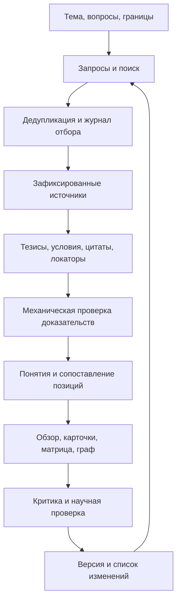

# Как устроен пример и что считать хорошим обзором

## Что проверено в исходном репозитории

Изучен публичный [grokking-conceptual-review](https://github.com/kraidiky/grokking-conceptual-review), фиксированная ревизия **`d951197c2164bf4098d06fe51543e18d76e82346`**, дата анализа — **28 октября 2026**. Прочитаны README, правила карточек, индекс понятий, карточка grokking и карточка исходной статьи Power et al.; проверен полный список путей. Это разбор устройства проекта и выборки страниц, а не научный аудит всего корпуса.

По [README этой ревизии](https://github.com/kraidiky/grokking-conceptual-review/blob/d951197c2164bf4098d06fe51543e18d76e82346/README.md) картотека содержит 90 понятий, 173 статьи основного корпуса и 46 внешних работ. У 103 основных статей заявлен полный русский перевод, у 70 — выдержки. Содержательная единица — карточка; читать всё подряд не обязательно.

В [правилах карточек](https://github.com/kraidiky/grokking-conceptual-review/blob/d951197c2164bf4098d06fe51543e18d76e82346/papers/README.md) описаны оригиналы, перевод, разбор утверждений и лицензионные записи. Ссылки адресуют абзацы, разделы и рисунки. Сохраняются авторские оговорки, исторический словарь и отличие наблюдений от объяснений. Ошибочные цитирования фиксируются с обеих сторон: у пересказывающей и у пересказанной статьи.

[Индекс понятий](https://github.com/kraidiky/grokking-conceptual-review/blob/d951197c2164bf4098d06fe51543e18d76e82346/concepts/index.md) организован инверсией «понятие → статьи»: сначала извлекаются сведения из отдельных работ, затем сводятся синонимы и группируются позиции. [Карточка grokking](https://github.com/kraidiky/grokking-conceptual-review/blob/d951197c2164bf4098d06fe51543e18d76e82346/concepts/grokking.md) показывает определения, уточнения и альтернативные трактовки с адресными цитатами.

В опубликованном дереве нет самостоятельного генератора, конфигов API и готового CLI. Правила ссылаются на `import-paper-card`, `quote_check.py`, `anchor_number.py` и другие инструменты из другого рабочего окружения. Поэтому нельзя утверждать, что публичный репозиторий позволяет воспроизвести авторский процесс одной командой. Review Forge реализует собственный конвейер по наблюдаемым принципам; скрытые промпты и скрипты не реконструированы.

## Какой именно это тип обзора

Это **conceptual literature review / evidence-linked research wiki**. Его задача — объяснить устройство области: какие понятия существуют, что авторы под ними понимают, какие механизмы предлагают и какими данными ограничиваются выводы.

Он отличается от простого дайджеста тем, что одна тема связывает много статей, а одна статья участвует в нескольких темах. Отличается и от формального systematic review: без воспроизводимой стратегии поиска, критериев и полного журнала отбора нельзя заявлять исчерпывающий охват или отсутствие selection bias.

Для будущего интерфейса наиболее полезна именно эта структура: **понятия + статьи + тезисы + адресные доказательства + версии**. Длинная связная глава — один из способов чтения этой структуры.

## Критерии идеального результата

| Критерий | Что должно быть | Как проверять |
|---|---|---|
| Чёткий вопрос | Какие вопросы решает обзор, для кого и на какую дату | Вопросы и границы указаны до поиска |
| Операциональные определения | Канонический термин, синонимы, альтернативные определения | Можно понять, при каких наблюдениях авторы используют термин |
| Прозрачный корпус | Запросы, источники, даты, ограничения, причины отбора | Включение и исключение каждой найденной работы объяснимо |
| Достаточное чтение | Версия полного текста или явный abstract-only статус | Аннотация не выдаётся за разбор методов и приложений |
| Проверяемые тезисы | Утверждение, источник, точный фрагмент, локатор | Цитата находится в сохранённом источнике |
| Эпистемический статус | Наблюдение, теорема, предположение, интерпретация | «Может объяснять» не превращается в «доказано вызывает» |
| Условия применимости | Данные, задача, split, модель, бюджет, протокол | Вывод не переносится за пределы исследованного режима без пометки |
| Синтез по понятиям | Сопоставление работ и способов объяснения | Понятие можно изучить без последовательного чтения всех статей |
| Честные противоречия | Что именно расходится и сравнимы ли условия | Различные задачи не выдаются за опровержение друг друга |
| Отрицательные свидетельства | Неудачи, контрпримеры, провалы репликаций, если найдены | Отбираются не только эффектные положительные результаты |
| Историческая точность | Кто и когда ввёл понятие, что появилось позже | Современная терминология не приписывается ранним авторам |
| Сравнимые измерения | Метрика вместе с единицами, железом и протоколом | Нет общего рейтинга из несопоставимых чисел |
| Удобное чтение | Краткий вход, карта понятий, маршруты, двусторонние ссылки | Можно пройти от вывода до доказательства и обратно |
| Воспроизводимость | Метаданные, версии, хеши, промпты, параметры, журналы | Можно объяснить, из каких входов возник конкретный снимок |
| Обновляемость | Стабильные ID, версии, список изменений и отложенных работ | Новые данные не стирают предыдущую картину области |

Каждый пункт можно оценивать редакторски: **0 — отсутствует; 1 — частично; 2 — проверяемо реализован**. Такой чеклист не следует превращать в автоматически вычисляемый «процент научной истинности». Ошибочная атрибуция или выдуманная ссылка блокируют готовность независимо от суммы баллов.

## Что добавить к наблюдаемому подходу

Ниже — предложения для нового инструмента, а не утверждение, что соответствующая информация нигде не присутствует в исходной картотеке.

1. **Явный протокол охвата.** Сохранять исходную выдачу, частичные отказы провайдеров, лимиты поиска, даты и решения. Число карточек само по себе ничего не говорит о полноте обзора.
2. **Матрицу условий и доказательств.** Для каждого тезиса показывать задачу, условия и ограничения рядом с источником. Для ускорений особенно важны hardware, batch size, precision, latency/throughput, baseline и качество выхода.
3. **Разделение авторского вывода и редакторского предложения.** Новые исследовательские идеи полезны, но их нельзя подавать как обнаруженный результат или установленный пробел во всей литературе.
4. **Отдельный поток новых публикаций.** Сначала обнаружение, затем проверка релевантности и доказательств, потом новая версия обзора. Это уменьшает бессодержательные еженедельные переписывания.
5. **Машиночитаемую модель данных.** Интерфейс должен читать тот же граф доказательств, из которого собраны Markdown-страницы. Две расходящиеся версии знаний поддерживать сложно.
6. **Явный статус качества.** Проверка ссылки, проверка дословности, критика моделью и научная проверка человеком — разные действия. Система должна сообщать, какие из них выполнены.
7. **Покрытие рисунков и формул как отдельный этап.** Это полезное будущее расширение. Текстовый PDF-парсер не даёт оснований заявлять, что иллюстрации и доказательства проверены.

Полный перевод каждой статьи полезен для чтения, но не обязателен для качественного обзора. Он увеличивает стоимость, объём и риск ошибок. В первой версии приоритет отдан проверяемым тезисам, условиям и связи между работами. Переводы целиком, перепубликация иллюстраций, автоматическое определение лицензий и анализ картинок не реализованы.

## Как такой обзор делать

Начинать лучше с вопроса вроде «когда speculative decoding ускоряет serving при больших batch size», а не со всего «ускорения AI». Большая категория подходит для вкладки интерфейса; внутри неё полезнее иметь несколько ограниченных обзоров.

В Review Forge каждый сегмент источника проходит извлечение, после чего модель выбирает ограниченный набор тезисов каждой статьи для общего синтеза. Отбор виден в карточке; все извлечённые тезисы сохранены. Это практический компромисс по контексту модели, который может пропустить важное свидетельство. Он не эквивалентен полному человеческому синтезу всей литературы.

Человеческая проверка перед использованием научных выводов должна как минимум сверить ключевые определения, самые сильные причинные утверждения, числа в сравнении методов, контрпримеры и ссылки на первоисточники. Система готовит проверяемый черновик и экономит организационную работу; научное качество нельзя гарантировать одним промптом.

## Лицензирование и атрибуция

Исходный проект распространяет редакторские материалы под CC BY-SA 4.0 и отдельно описывает обращение с лицензиями статей. Новый код написан самостоятельно; заимствования текстов карточек, переводов и изображений в нём нет. Перед будущей публикацией результатов нужно отдельно проверить права на конкретные используемые материалы. Программа не делает юридических выводов по названию лицензии и не публикует оригиналы автоматически.
